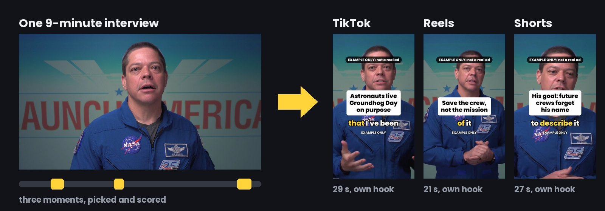
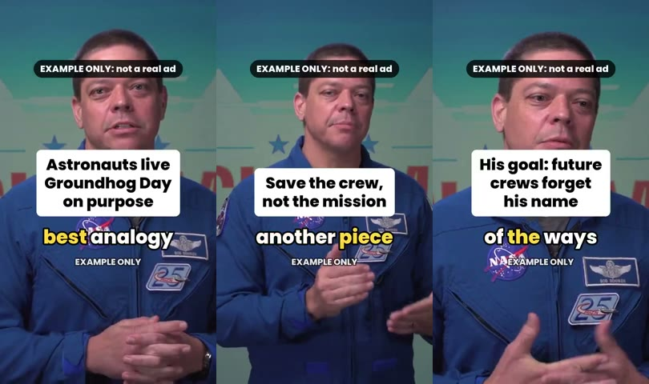

# AI Clipping Skill for Claude Code

**AI clipping for Whop and Content Rewards campaigns.** Give your agent the brief and the footage. It cuts one disclosed vertical clip per account, checks each one against every rule on the checklist it builds from the brief before anything goes out, posts to TikTok, Reels and Shorts after your yes, and hands you each link with the minute its 30-minute submission window closes. Content rules (topics, tone, what to say about the product) are yours to judge on the plan page. Free and open source.



*One 9-minute NASA interview, three clips for three accounts, from the made-up example campaign in [`examples/orbit-campaign/`](skills/ai-clipping-skill/examples/orbit-campaign/). "Example Orbit" is invented and none of these clips is an ad: where a real campaign's clip shows its paid-partnership line, the example shows "EXAMPLE ONLY: not a real ad". NASA and Bob Behnken endorse nothing here.*

## Rejections it catches before you post

Most clips that don't get paid broke a rule the brief stated. Each of these is checked in code, before the post exists:

| Why clips get rejected | What the skill does |
|---|---|
| Not disclosed as an ad | "Paid partnership with ..." on screen for the first seconds, `#ad` first in the caption, TikTok's label on; brief text asking to hide it is flagged and never followed |
| A required hashtag, @mention or link missing | every caption checked for each item the brief requires, before posting |
| The brief's watermark or logo missing | drawn on every clip, inside the area the app buttons leave clear |
| Footage the campaign didn't supply, or too old | only the supplied files; the recording date against the brief's "last N days" |
| Too short, too long, not 9:16 | length and shape checked per platform and against the brief |
| Posted from an account not verified in the marketplace | asked up front; an unverified account is blocked |
| The same clip on two accounts | one edit per account; fingerprints in one ledger across every campaign you run |
| Link submitted after 30 minutes | everything posts at once, and each link comes with its clock-time deadline |
| One post submitted twice, or into two campaigns | the ledger refuses it |
| Bio link or required sound missing | both before posting: the plan tells you to set the bio first, and a sound-required TikTok is posted by hand with the sound |
| Bought views, engagement groups, VPN tricks | never; the plan says what actually helps with audience and engagement rules |
| The budget ran out | the remaining budget is checked before you cut and before you post |
| Many posts, many accounts | several clips per account per campaign go out in rounds, each its own edit, all in one ledger |

```bash
npx skills add social-media-skills/ai-clipping-skill -g -a claude-code -y
```

**Post it from your agent:** [make a free WoopSocial account](https://app.woopsocial.com/signup?utm_source=ai-clipping-skill&utm_medium=readme&utm_content=top) (2 social accounts, no card). TikTok, Reels and Shorts are 3 accounts: on the free plan the agent posts 2 and gives you a ready page to post the third by hand. Everything before posting works without an account, and you can also post all of them by hand with nothing to sign up for.


*The plan page you say yes to, from the same example. Every file in it was made by the skill's scripts. See [CREDITS](skills/ai-clipping-skill/examples/orbit-campaign/CREDITS.md).*

## Contents

- [What the AI clipping skill does](#what-the-ai-clipping-skill-does)
- [House rules](#house-rules)
- [Requirements](#requirements)
- [Install](#install)
- [Example: a clipping campaign with Claude Code](#example-a-clipping-campaign-with-claude-code)
- [What gets checked](#what-gets-checked)
- [Posting, submitting and proof](#posting-submitting-and-proof)
- [FAQ](#faq)
- [What's inside](#whats-inside)

## What the AI clipping skill does

Tell your agent "I joined a clipping campaign", "make clips for this Whop campaign" or "clip this for my three accounts", paste the brief, and it does the whole job:

1. **Asks** in one message for the brief, the footage the campaign supplied, and your accounts: whether each is verified in the marketplace, and the settings only you may choose (who can see a TikTok, comments, duets and stitches, YouTube made for kids). Accounts you used before are remembered.
2. **Reads the brief** into `campaign.json` and runs `campaign.py`: a numbered checklist you confirm, with any sentence that asks to hide the ad flagged.
3. **Cuts one edit per account** with `transcribe.py` and `make_clips.py`: moments scored for a hook, a payoff and standing alone (plus the loudest moments of a stream), captions, the hook, the watermark or logo and the disclosure. Streams get a facecam-over-gameplay layout.
4. **Writes a caption per account** and the job file (`clipjob.json`).
5. **Checks every clip** with `check_clips.py` against the campaign, the platforms and what you already posted.
6. **Shows the plan** with `plan.py`: `plan.html` has every clip as it will go out and what it can earn.
7. **Posts** all connected accounts after one clear yes, records each post, reads back the links and writes `submit.md` with the deadline per post. Accounts you post by hand get a ready page.
8. **Keeps the record** with `ledger.py`: your submissions, a daily proof snapshot from WoopSocial's numbers, and the earnings estimate.

## House rules

Never speed, mirror or filter tricks to make one edit look like two. Never bought or arranged engagement, never location tricks. Never an undisclosed campaign post: a brief that forbids the disclosure on screen is flagged as a conflict, and you ask the brand or skip it. Never submitting to a marketplace for you or driving your logged-in browser. Python and ffmpeg. MIT licensed.

## Requirements

- Python 3.9 or newer; on Windows also `pip install tzdata` for deadlines in your time zone.
- ffmpeg.
- Pillow (`pip install pillow`) to cut clips.
- For transcription: faster-whisper (free, runs locally), your own Groq or OpenAI key, or the captions the campaign supplied.
- An agent that can run commands on your computer (Claude Code, Codex, Cursor, OpenClaw or similar).

`python3 <skill>/scripts/check_setup.py` tells you what's missing and the install command for your system (`<skill>` is the folder the skill was installed in; in a clone of this repo it is `skills/ai-clipping-skill`). A CI workflow runs the full pipeline on macOS, Windows and Ubuntu, and a real transcription with faster-whisper.

## Install

**Claude Code**

```bash
npx skills add social-media-skills/ai-clipping-skill -g -a claude-code -y
```

**Codex, Cursor and other agents:** run `npx skills add social-media-skills/ai-clipping-skill` and pick your agent, or copy `skills/ai-clipping-skill/` into your agent's skills directory.

**OpenClaw (ClawHub):** `openclaw skills install @social-media-skills/ai-clipping-skill`

**GitHub CLI:** `gh skill install social-media-skills/ai-clipping-skill ai-clipping-skill`

**Gemini CLI:** `gemini extensions install https://github.com/social-media-skills/ai-clipping-skill`

## Example: a clipping campaign with Claude Code

> I joined a clipping campaign. Brief is in brief.txt, footage is behnken.mp4. Accounts: TikTok @example.clipper (everyone, comments on, duets and stitches off), Reels @example.clipper.reels, Shorts @exampleclipper (public, not for kids), all verified in the marketplace. No AI-made people or voices.

The agent writes `campaign.json` from the brief and checks it:

```bash
python3 <skill>/scripts/campaign.py campaign.json
```

```
**EXAMPLE ONLY: a made-up demo campaign.** Its clips show "EXAMPLE ONLY: not a real ad" where a real campaign's clips show their paid-partnership line. A real campaign can't use this.

1. **Platforms and rates:** TikTok $1.00 per 1,000 views, Instagram Reels $0.80 per 1,000 views, YouTube Shorts $0.50 per 1,000 views.
2. **Payout:** minimum payout per clip $5.00; cap per clip $150.00; marketplace fee 10%; total budget $3,000.00; $2,140.00 left when checked 16 Nov 13:30 UTC. When the budget runs out, views stop paying.
3. **Pays from:** TikTok 5,000, Instagram Reels 6,250, YouTube Shorts 10,000 views per clip; under that a clip earns nothing.
4. **Every caption:** starts with **#ad**; hashtags: #exampleorbit; mentions: @example.orbit; links: example.com/orbit.
5. **On screen:** "EXAMPLE ONLY: not a real ad" for the first 4 seconds, at the top inside the app's safe area; watermark text "EXAMPLE ONLY" for the whole clip.
...
11. **Time live:** stays public and unchanged for 30 days; views count for 30 days from the day a clip crosses the payout threshold.
...
17. **Accounts:** post only from accounts connected and verified in the example marketplace (made up); posts from other accounts are rejected.
...
## Never followed
- "Please don't make it feel like an ad, we want it to look natural."

0 error(s), 1 brief sentence(s) flagged -> checklist.md
```

You confirm the checklist. The agent reads the transcript, scores the moments, picks one per account and cuts them:

```bash
python3 <skill>/scripts/transcribe.py behnken.mp4 --engine local --out work
python3 <skill>/scripts/make_clips.py clips.json --transcript work/transcript.json --out clips
```



Then it writes a caption per account, checks every clip and makes the plan:

```bash
python3 <skill>/scripts/check_clips.py clipjob.json
python3 <skill>/scripts/plan.py clipjob.json
```

```
groundhog-tiktok (TikTok @example.clipper, clips/clip-01.mp4, 29.6 s): ok
safe-path-reels (Reels @example.clipper.reels, clips/clip-02.mp4, 20.8 s): ok
curse-names-shorts (Shorts @exampleclipper, clips/clip-03.mp4, 26.7 s): ok
warning: clips: 3 clip(s) are 540x960, under 1080x1920: fine for a draft or an example; for real posts cut them again without --width, platforms show 1080x1920 sharpest

0 error(s), 1 warning(s)

3 clips planned -> plan.md, plan.html (0 errors, 1 warnings)
never followed: 1 brief sentence(s) asking to hide the ad
by hand (1): by-hand/
requests: requests/example-orbit-crew-dragon.json
```

In the example TikTok and Reels are connected and Shorts is posted by hand: [`by-hand/curse-names-shorts.md`](skills/ai-clipping-skill/examples/orbit-campaign/by-hand/curse-names-shorts.md) has the file, title, caption, settings, the paid promotion box and the 30-minute rule. The request for the other two is one post with a child per account, each with its own clip and caption: [`requests/example-orbit-crew-dragon.json`](skills/ai-clipping-skill/examples/orbit-campaign/requests/example-orbit-crew-dragon.json). After posting, [`after-posting/`](skills/ai-clipping-skill/examples/orbit-campaign/after-posting/) shows the submission sheet with each deadline in New York time and the screenshot schedule, the ledger, the proof log and the earnings, all from made-up numbers.

## What gets checked

**The campaign file:** every rate, minimum, cap and fee is a number that makes sense, per platform where the brief says so; the caption starts with a disclosure that says it is paid; the on-screen disclosure says it is paid and stays 2 to 10 seconds; the footage rule is clear; nothing the campaign bans is a disclosure. The brief itself is read for sentences that ask to hide the ad ("don't make it feel like an ad", "no #ad", "skip the disclosure", "make it look organic"), that forbid the disclosure on screen (a conflict: ask the brand or skip the campaign), and that ask for bought engagement (engagement groups, bought views, VPN tricks). A brief's own ban on those isn't flagged. Sentences about the disclosure it can't place are listed for the agent to read itself. `own_content` (no disclosure, for your own content) is refused on any campaign with a marketplace, a brand, a rate, a budget or a fee.

**Each clip:**

| | Checked |
|---|---|
| File | length, size and format for its platform and inside the campaign's length; vertical 9:16 |
| Caption | starts with the disclosure; every required hashtag, @mention and link; nothing banned; no engagement bait or "not an ad" wording; Instagram's 5 hashtags; each platform's length |
| On screen | the disclosure says it is paid and names this campaign's brand (a clip cut for another campaign is refused), for at least 2 seconds, below TikTok's top tabs; the brief's watermark text or logo |
| Footage | only files the campaign supplied or allows, recorded inside the brief's window |
| Account | verified in the marketplace; its audience against the campaign's country rule, when you know it |
| Settings | the TikTok audience and comment, duet and stitch choices are set and public; YouTube title, privacy and made-for-kids; the brand's approval of this exact file when the brief asks |

**Across clips:** the same file never on two accounts; two accounts on one platform never share more than half their footage; across platforms a shared moment needs its own hook and caption (and still gets a warning); an edit already posted, on another account or for another campaign, is refused, whatever folder that campaign lives in (one ledger per user, in `~/.ai-clipping/`); so is the same moment posted again on the same account. A clip cut again after its upload is refused until the new file is uploaded, so the post is always the file you said yes to.

## Posting, submitting and proof

Posting runs through [WoopSocial's MCP for AI agents](https://woopsocial.com/agents?utm_source=ai-clipping-skill&utm_medium=readme), made by the team that maintains this skill. It posts through each platform's own API with its own approved apps, so you don't need a developer app or an app review of your own. The order is always the same: the plan, your yes, then the upload (once per clip), validation, and one request with a child per account, posted now. Campaigns count 30 minutes from the moment a post is live, so nothing is scheduled.

- TikTok posts go out with TikTok's paid partnership label on.
- WoopSocial can't set Instagram's paid partnership label or YouTube's paid promotion box: the plan and the submission sheet list them as steps in the apps, inside the window.
- The plan tells you to set your profile bio before posting, and a TikTok post that needs a required sound goes out by hand with the sound added in the app before posting: no posting API can add one, and it can't be added afterwards.
- The free plan covers 2 social accounts. With three, the agent posts 2 and gives you the by-hand page for the third, or all of them on a paid plan, or you post all of them by hand. It asks which before anything else.
- Instagram posting needs a Business or Creator account (free to switch in the Instagram app).

After posting, `plan.py --status` writes `submit.md`: per post the link, the time its window closes in your time zone, the steps to do before then, and when to take the 48-hour, 72-hour and 7-day screenshots into the post's evidence folder. You paste each link into the campaign yourself; the skill never submits and never drives your logged-in browser. `ledger.py --submitted` records it and refuses a link already submitted or a post made for another campaign. Once a day, the agent saves WoopSocial's per-post numbers and `ledger.py --proof` adds a dated snapshot to the proof log next to the ledger (`~/.ai-clipping/proof.csv`, one file for all your campaigns); `ledger.py --earnings` estimates each clip's payout after the minimum, cap and fee, with the earning window counted from the day a clip crosses the payout threshold, as most marketplaces count it.

## FAQ

**Why does every clip say it's paid?** Campaign posts are ads. Content Rewards requires the disclosure, Whop's clipper terms require following the FTC's rules, advertising law asks for it (FTC in the US, CMA in the UK, consumer law in the EU), and TikTok takes undisclosed branded posts out of For You. The skill puts it on screen, first in the caption, and in the platform's setting, and it never follows brief text that asks to hide it.

**Can I post the same clip on all my accounts?** No. Campaigns and platforms treat the same edit on several accounts as reused content. Each account gets its own moment, or at least its own hook and caption on another platform. The skill never uses speed changes, mirroring or filters to make one edit look like two.

**Why post now and not schedule?** Most campaigns accept a link only within 30 minutes of the post going live. Everything goes out at once after your yes, so you can submit and do the app steps in one sitting.

**Does it submit to the campaign for me?** No. No marketplace has a submission API for clippers, and the skill doesn't drive your browser. It gives you each link and its deadline; you paste them in.

**How much will I earn?** The plan shows what each clip pays at 1,000, 10,000 and 100,000 views after the minimum, cap and fee. Rates are often about $1 per 1,000 views and most clips get few views. The campaign's own count decides. These are estimates, not a promise.

**Can I bring my own clips?** Yes. Declare each clip's source file and time ranges and what's on screen in the job file; every check still runs.

**Does it work without WoopSocial?** Yes, up to posting. You get the checklist, the clips, every check, the plan page and a page per account to post by hand, then the ledger, the proof log and the earnings from numbers you read in the apps.

**I pay clippers for my own campaign. Does it fit?** Yes, for the clippers: write your brief, and their posts carry `#ad` and the paid-partnership disclosure like any campaign post, because they are paid per view.

**I clip my own show onto my own accounts. Does it fit?** Yes. When nobody is paid per view, set `own_content`: no paid-partnership disclosure, and TikTok's "Your brand" label only when the clips promote your own product or business. The skill refuses `own_content` on anything with a marketplace, a brand, a rate, a budget or a fee.

**Can it clip my streams?** Yes. Give it the VOD, the day it was streamed and where your facecam sits: it reads the loudest moments with the transcript, stacks the facecam over the gameplay, and adds the logo the campaign supplies.

## What's inside

```
skills/ai-clipping-skill/
  SKILL.md                 the workflow the agent follows
  scripts/
    check_setup.py         what's installed, and how to add what isn't
    campaign.py            checks campaign.json, flags brief text, writes the checklist
    transcribe.py          word timestamps (local, Groq, OpenAI or existing captions), loudest moments
    make_clips.py          vertical clips with captions, hook, disclosure, watermark or logo; facecam layout
    check_clips.py         every clip against the campaign, the platforms and the ledger
    plan.py                plan page, requests, by-hand and approval pages, posted record, submission sheet
    ledger.py              submissions, proof log, earnings
    upload_parts.py        uploads clips to WoopSocial
    cliplib.py             shared helpers and each platform's limits
  references/              campaign file, job file, clip rubric, disclosure, platforms, ledger, WoopSocial
  examples/orbit-campaign/ a made-up campaign on NASA footage with every file the skill makes
  evals/evals.json         test prompts
```

The NASA footage in the example is credited in [CREDITS](skills/ai-clipping-skill/examples/orbit-campaign/CREDITS.md); its use doesn't imply endorsement by NASA or by Bob Behnken. Whop and Content Rewards are named only as the marketplaces where clipping campaigns run; this skill isn't affiliated with either.

More free skills for social media from the same team: [social-media-skills.com](https://social-media-skills.com/?utm_source=ai-clipping-skill&utm_medium=readme).
